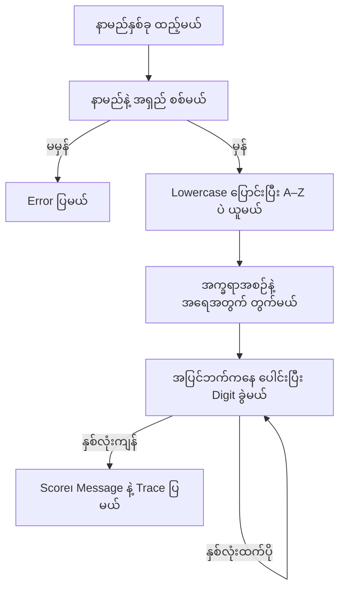

# Burma Love Calculator (အပျော်တမ်း နာမည်လိုက်ဖက်မှု)

နာမည်နှစ်ခုကို ထည့်ပြီး စာလုံးအရေအတွက်အပေါ် အခြေခံတဲ့ အပျော်တမ်း Score ကို တွက်ကြည့်နိုင်တဲ့ Blazor WebAssembly Project ပါ။ [App ကို ဒီမှာ ဖွင့်နိုင်ပါတယ်](https://blazor-burma-love-calculator.vercel.app/)။

[Burma Project Ideas](https://github.com/burma-project-ideas) အောက်မှာ နောက်လာမယ့်သူတွေ လေ့လာနိုင်ဖို့၊ ကိုယ်နှစ်သက်တဲ့ Programming Language နဲ့ ပြန်ရေးကြည့်နိုင်ဖို့ ထားပေးထားတာပါ။ ရလဒ်က ချစ်ခြင်းမေတ္တာ၊ ဆက်ဆံရေးအရည်အသွေးနဲ့ အနာဂတ်ကို တိုင်းတာပေးတာ မဟုတ်ပါဘူး။

## အသုံးပြုပုံ

1. **Your name** နဲ့ **Their name** မှာ နာမည်တစ်ခုစီ ထည့်ပါ။ English အက္ခရာနဲ့ ရေးထားတဲ့ မြန်မာနာမည်တွေလည်း သုံးနိုင်ပါတယ်။
2. **Calculate our match** ကို နှိပ်ပါ၊ သို့မဟုတ် Input မှာ Enter နှိပ်ပါ။
3. Score နဲ့ သက်ဆိုင်ရာ Message ကို ပြပေးပါမယ်။ **See how we got …%** ကို ဖွင့်ရင် တွက်ချက်ထားတဲ့ Round တွေကို ကြည့်နိုင်ပါတယ်။
4. နာမည်ပြင်လိုက်ရင် ရလဒ်ဟောင်းကို ရှင်းပါတယ်။ ပြန်တွက်ချင်ရင် Button ကို ပြန်နှိပ်ပါ။

Mobile Layout၊ Light/Dark Theme၊ Keyboard နဲ့ Reduced Motion ကို ပံ့ပိုးထားပါတယ်။ နာမည်တွေကို Server API ဆီ မပို့ဘဲ Browser ထဲမှာပဲ တွက်ပါတယ်။ Theme ရွေးချယ်မှုကိုပဲ Browser ရဲ့ Local Storage မှာ သိမ်းထားပါတယ်။

## App ရဲ့ Workflow

### ၁။ နာမည်တွေ စစ်မယ်

`Pages/Home.razor` က Form Submit ကို လက်ခံပြီး `LoveCalculatorService.CalculateCompatibility()` ဆီ ပို့ပါတယ်။ နာမည်နှစ်ခုလုံး လိုအပ်ပြီး တစ်ခုစီမှာ A–Z အက္ခရာ အနည်းဆုံးတစ်လုံး ပါရပါမယ်။ နာမည်တစ်ခုကို အများဆုံး Character ၈၀ အထိ လက်ခံပါတယ်။ မြန်မာ Unicode အက္ခရာနဲ့ပဲ ရေးထားတဲ့ နာမည်ကို တွက်မပေးပါဘူး။

မမှန်ကန်တဲ့ Input ဖြစ်ရင် Error Message ကို ပြပြီး ရလဒ် မထုတ်ပေးပါဘူး။

### ၂။ စာလုံးတွေ သန့်စင်မယ်

နာမည်နှစ်ခုကို အစဉ်လိုက် ပေါင်းပြီး `ToLowerInvariant()` နဲ့ Lowercase ပြောင်းပါတယ်။ Regex `[^a-z]` နဲ့ Space၊ ဂဏန်း၊ Punctuation နဲ့ အခြားအက္ခရာတွေကို ဖယ်ပါတယ်။ ဒါကြောင့် `Alice!` နဲ့ `Bob123` က `Alice` နဲ့ `Bob` အတိုင်း တွက်ပေးပါတယ်။

မတူညီတဲ့ English အက္ခရာ အနည်းဆုံး နှစ်လုံး လိုအပ်ပါတယ်။ `aaa` နဲ့ `aaa` လို အက္ခရာတစ်မျိုးတည်းရှိတဲ့ Input ကို Error ပြပါတယ်။

### ၃။ ပထမဆုံး တွေ့တဲ့အစဉ်အလိုက် ရေတွက်မယ်

`Dictionary<char, int>` နဲ့ အက္ခရာတစ်လုံးစီ ဘယ်နှကြိမ် ပါလဲ ရေတွက်ပါတယ်။ `seenChars` မှာ ပထမဆုံး တွေ့တဲ့အစဉ်ကို ထိန်းထားပါတယ်။ Count က ဂဏန်းနှစ်လုံးနဲ့အထက် ဖြစ်နေရင် Decimal Digit တစ်လုံးချင်း ခွဲပါတယ်။ ဥပမာ `20` ကို `[2, 0]` လို ပြောင်းပါတယ်။

`Alice` နဲ့ `Bob` အတွက် `alicebob` ထဲက အက္ခရာအစဉ်က `a, l, i, c, e, b, o` ဖြစ်ပြီး Count တွေက `[1, 1, 1, 1, 1, 2, 1]` ဖြစ်ပါတယ်။

### ၄။ အပြင်ဘက်ကနေ အတွင်းဘက်ကို ပေါင်းမယ်

ပထမဂဏန်းနဲ့ နောက်ဆုံးဂဏန်းကို ပေါင်းပြီး အတွင်းဘက်ဆီ ဆက်သွားပါတယ်။ အလယ်မှာ တစ်လုံးတည်း ကျန်ရင် အဲ့ဒီဂဏန်းကို ဆက်ယူပါတယ်။ ပေါင်းလဒ် `10` နဲ့အထက် ဖြစ်ရင် Digit နှစ်လုံး ခွဲပါတယ်။

ဂဏန်းနှစ်လုံးပဲ ကျန်တဲ့အထိ ဒီလုပ်ဆောင်ချက်ကို ထပ်လုပ်ပြီး Round တစ်ခုစီရဲ့ Input/Output ကို `TraceStep` အဖြစ် သိမ်းထားပါတယ်။

```text
Alice + Bob
[1, 1, 1, 1, 1, 2, 1]
          ↓
      [2, 3, 2, 1]
          ↓
         [3, 5]
          ↓
          35%
```

### ၅။ ရလဒ်နဲ့ Trace ကို ပြမယ်

နောက်ဆုံး Digit နှစ်လုံးကို ဆက်ပြီး Score `0–99` ကို ထုတ်ပါတယ်။ Score အလိုက် ရှိပြီးသား Message အုပ်စုတွေကို ပြပါတယ်။ `Trace` ကို Expand လုပ်ပြီး Round တွေ စစ်ကြည့်နိုင်ပါတယ်။ နာမည်တူ၊ ထည့်တဲ့အစဉ်တူရင် ရလဒ်တူပါတယ်။ **နာမည်နှစ်ခုရဲ့ အစဉ်ပြောင်းရင် Score ပြောင်းနိုင်ပါတယ်**။ ဥပမာ `Alice + Bob` က `35%`၊ `Bob + Alice` က `44%` ပါ။



## Project ဖွဲ့စည်းပုံ

| နေရာ | တာဝန် |
| --- | --- |
| `Pages/Home.razor` | Input Form၊ Validation Message၊ Result နဲ့ Trace |
| `LoveCalculatorService.cs` | Input စစ်ခြင်း၊ Sanitization၊ Counting နဲ့ Reduction |
| `Layout/MainLayout.razor` | Header၊ Navigation၊ Theme နဲ့ Footer |
| `Shared/PrestigeShineButton.razor` | Blazor သို့ Adapt လုပ်ထားတဲ့ Prestige UI Button |
| `wwwroot/css/app.css` | Tailwind Input၊ Theme Tokens နဲ့ Responsive Layout |
| `wwwroot/fonts/` | Self-hosted Outfit နဲ့ Noto Sans Myanmar၊ License များ |
| `tests/` | Dependency မလိုတဲ့ Console Regression Checks |
| `.github/workflows/deploy.yml` | Install၊ Build၊ Checks၊ Publish နဲ့ Vercel Deploy |

## Local မှာ Run မယ်

**.NET 10 SDK** နဲ့ **Node.js/npm** လိုပါတယ်။

```bash
git clone https://github.com/burma-project-ideas/burma-love-calculator.git
cd burma-love-calculator
npm ci
dotnet watch --project blazor-burma-love-calculator.csproj
```

Terminal မှာ ပြထားတဲ့ URL ကို Browser မှာ ဖွင့်ပါ။ MSBuild Target က CSS ကို အလိုအလျောက် Build လုပ်ပါတယ်။ CSS သီးသန့် Watch လုပ်ချင်ရင် နောက် Terminal မှာ `npm run build:css` ကို သုံးပါ။

```bash
dotnet run --project tests/CalculatorChecks.csproj
npm audit
dotnet publish blazor-burma-love-calculator.csproj -c Release -o publish_output
```

Static Output က `publish_output/wwwroot` ဖြစ်ပါတယ်။ Vercel Workflow က `vercel.json` ကို Output ထဲ Copy လုပ်ပြီး SPA Fallback ကို သတ်မှတ်ထားပါတယ်။ `VERCEL_TOKEN`၊ `VERCEL_ORG_ID`၊ `VERCEL_PROJECT_ID` Repository Secrets လိုပါတယ်။

## Credits နဲ့ License

- App နဲ့ Calculation Implementation: [Sann Lynn Htun (@sannlynnhtun-coding)](https://github.com/sannlynnhtun-coding)
- UI: [Prestige UI](https://prestigeui.com/) ရဲ့ MIT-licensed ShineButton နဲ့ NavbarPill Styling ကို Blazor အတွက် Adapt လုပ်ထားပါတယ်။ Calculator Form နဲ့ Result/Trace Layout က ဒီ App အတွက် သီးသန့်ရေးထားတာပါ။
- Fonts: Outfit နဲ့ Noto Sans Myanmar ကို SIL Open Font License နဲ့ Self-host လုပ်ထားပါတယ်။

အသေးစိတ်ကို [THIRD_PARTY_NOTICES.md](THIRD_PARTY_NOTICES.md) မှာ ဖတ်နိုင်ပါတယ်။ ဒီ Project က အပျော်တမ်းလေ့လာရေး Project ဖြစ်ပြီး Relationship Prediction သို့မဟုတ် သိပ္ပံနည်းကျ Metric မဟုတ်ပါဘူး။
